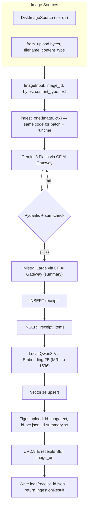

# Receipt Ingestion Pipeline

## Architecture

The pipeline is split into three concentric layers so the source of an image is decoupled from how it gets processed:

1. **Sources** (outer, swappable) — produce `ImageInput` instances. `DiskImageSource` for batch, `from_upload(...)` factory for runtime uploads. Anything that yields normalized image bytes + an id can be a source.
2. **Orchestrator** (`ingest_one`) — pure function over `(ImageInput, IngestionContext)`. Source-agnostic.
3. **Steps** (Gemini, Mistral, embeddings, D1, Vectorize, Tigris, observability) — single-purpose modules, composed by the orchestrator. Reused identically across sources.



## File Layout

The `app/ingestion/` package is the reusable library. `app/ingest_receipts.py` is just one of many possible callers (a future FastAPI handler is another).

```
app/
  ingest_receipts.py            # CLI caller (batch over disk)
  ingestion/
    __init__.py                 # re-exports ingest_one, IngestionContext, ImageInput, build_context
    pipeline.py                 # ingest_one(image, ctx) -> IngestionResult  (the orchestrator)
    context.py                  # IngestionContext + build_context() factory
    sources/
      __init__.py               # ImageInput dataclass + ImageSource Protocol
      disk.py                   # DiskImageSource(directory) -> Iterator[ImageInput]
      upload.py                 # from_upload(filename, content_type, data) -> ImageInput
    schemas.py                  # Receipt, ReceiptItem (Pydantic, with the +/-5% validator)
    prompts.py                  # markdown prompt loader/cache
    gemini.py                   # extract_receipt(image, ctx) -> (Receipt, RetryStats, TokenStats)
    mistral.py                  # summarise(receipt, ctx) -> (str, TokenStats)
    rate_limit.py               # GeminiRateLimiter (5 RPM, monotonic gate)
    embeddings.py               # lazy SentenceTransformer + MRL truncation to 1536
    d1.py                       # insert_receipt / insert_items / update_image_url
    vectorize.py                # upsert(receipt_id, vec, metadata)
    tigris.py                   # upload_artifacts(...) -> image_url
    observability.py            # configure_logging, bind_image, Stopwatch, configure_logfire
    canonical_log.py            # CanonicalLog model + writer
    result.py                   # IngestionResult (return value of ingest_one)
  prompts/
    receipt_extraction.md       # Gemini system+user prompt
    receipt_summary.md          # Mistral system prompt
  logs/                         # git-ignored canonical JSON logs
```

Notes on each file:

- [app/ingestion/schemas.py](app/ingestion/schemas.py) — `ReceiptItem` and `Receipt` Pydantic models. `Receipt` validator raises `ValueError` on `sum(items.total_price) != subtotal ±5%`, future-dated `date`, and negative amounts.
- [app/ingestion/prompts.py](app/ingestion/prompts.py) — reads markdown from `app/prompts/` and caches it; one function per prompt name.
- [app/ingestion/gemini.py](app/ingestion/gemini.py) — `extract_receipt(image: ImageInput, ctx: IngestionContext) -> (Receipt, RetryStats, TokenStats)` using `pydantic-ai` `Agent`. `output_type=Receipt` + `ModelRetry` handles the schema/sum-check retry loop natively, bounded by `MAX_OCR_RETRIES = 3`.
- [app/ingestion/mistral.py](app/ingestion/mistral.py) — `summarise(receipt: Receipt, ctx: IngestionContext) -> (str, TokenStats)` using a separate `pydantic-ai` `Agent` against the gateway's Mistral route.
- [app/ingestion/rate_limit.py](app/ingestion/rate_limit.py) — `GeminiRateLimiter`. Lives on the `IngestionContext` so a long-running FastAPI process shares one rate limiter across requests, not a fresh one per call.
- [app/ingestion/embeddings.py](app/ingestion/embeddings.py) — `Embedder` class wrapping a lazy `SentenceTransformer`; instantiated once on the `IngestionContext` so the model is loaded once per process (critical for runtime latency).
- [app/ingestion/vectorize.py](app/ingestion/vectorize.py) — `upsert(ctx, receipt_id, vector, store_name, date)` using the `cloudflare` SDK with metadata `{receipt_id: int, store_name: str, date: str}`.
- [app/ingestion/d1.py](app/ingestion/d1.py) — `insert_receipt(ctx, ...) -> int`, `insert_items(ctx, receipt_id, items)`, `update_image_url(ctx, receipt_id, url)`. Mirrors the style in [app/ingest_kb.py](app/ingest_kb.py).
- [app/ingestion/tigris.py](app/ingestion/tigris.py) — `upload_artifacts(ctx, receipt_id, image: ImageInput, raw_json, summary) -> image_url`. Writes three keys: `{rid}/{rid}-image.{ext}`, `{rid}/{rid}-ocr.json`, `{rid}/{rid}-summary.txt`.
- [app/ingestion/observability.py](app/ingestion/observability.py) — `bind_image(image_id)`, `Stopwatch`, `configure_logging()`, `configure_logfire()`.
- [app/ingestion/canonical_log.py](app/ingestion/canonical_log.py) — `CanonicalLog` model + writer to `logs/<receipt_id_or_image_id>.json`.
- [app/ingestion/result.py](app/ingestion/result.py) — `IngestionResult` (return type for runtime callers — see below).

## Source-agnostic image input ([app/ingestion/sources/__init__.py](app/ingestion/sources/__init__.py))

```python
class ImageInput(BaseModel):
    image_id: str           # log/canonical-log key BEFORE a D1 receipt_id exists
    data: bytes
    content_type: str       # e.g. "image/jpeg"
    extension: str          # ".jpg" — preserved for the Tigris key
    display_name: str | None = None   # original filename, for human logs

class ImageSource(Protocol):
    def __iter__(self) -> Iterator[ImageInput]: ...
```

Two concrete sources:

- [app/ingestion/sources/disk.py](app/ingestion/sources/disk.py)
  ```python
  class DiskImageSource:
      def __init__(self, directory: Path, *, sort: bool = True): ...
      def __iter__(self) -> Iterator[ImageInput]:
          # image_id = file stem ("receipt1"); extension = file suffix; content_type from mimetypes
  ```
- [app/ingestion/sources/upload.py](app/ingestion/sources/upload.py)
  ```python
  def from_upload(filename: str, content_type: str, data: bytes) -> ImageInput:
      # image_id = f"upload-{uuid4().hex[:8]}"; preserves filename in display_name
  ```

A future FastAPI handler is then trivial (and out of scope for this plan but proves the seam):

```python
@app.post("/receipts")
async def upload_receipt(file: UploadFile, ctx: IngestionContext = Depends(get_ctx)):
    image = from_upload(file.filename, file.content_type, await file.read())
    result = ingest_one(image, ctx)
    return result.public_payload()  # receipt_id, summary, image_url, validation
```

## IngestionContext ([app/ingestion/context.py](app/ingestion/context.py))

Holds everything a step needs that is expensive to construct or must be shared:

```python
@dataclass
class IngestionContext:
    cfg: Config
    cf_client: Cloudflare
    s3_client: Any                  # boto3 s3 client
    cloudflare_account_id: SecretStr
    rate_limiter: GeminiRateLimiter
    embedder: Embedder              # lazy-loaded SentenceTransformer wrapper
    gemini_agent: Agent             # pydantic-ai agent, built once
    mistral_agent: Agent            # pydantic-ai agent, built once

def build_context(config_path: str = "config.toml") -> IngestionContext:
    """Single entry to construct a fully-wired context. Used by CLI, FastAPI startup, tests."""
```

Importantly: `gemini_agent`, `mistral_agent`, `embedder`, and `rate_limiter` are constructed once. The CLI builds one context and reuses it across all 37 receipts; a FastAPI app builds one at startup (`@app.on_event("startup")` or a lifespan) and reuses it across all requests. No step constructs heavy objects on its own.

## Orchestrator ([app/ingestion/pipeline.py](app/ingestion/pipeline.py))

A single source-agnostic function that both callers share:

```python
def ingest_one(image: ImageInput, ctx: IngestionContext) -> IngestionResult:
    """Run the full pipeline for one image. Always returns an IngestionResult,
    even on failure. Always writes a canonical log file."""
    log = bind_image(image.image_id)
    timings: dict[str, float] = {}
    tokens = TokenAccumulator()
    retries = RetryCounts()
    receipt_id: int | None = None
    receipt: Receipt | None = None
    summary: str | None = None
    image_url: str | None = None
    error: str | None = None
    try:
        with logfire.span("ingest", image_id=image.image_id):
            with Stopwatch("ocr", timings), logfire.span("ocr"):
                receipt, ocr_retries, gem_tokens = extract_receipt(image, ctx)
                retries.ocr_validation_retries += ocr_retries
                tokens.add_gemini(gem_tokens)
            with Stopwatch("summary", timings), logfire.span("summary"):
                summary, mis_tokens = summarise(receipt, ctx)
                tokens.add_mistral(mis_tokens)
            with Stopwatch("db_insert", timings), logfire.span("db_insert"):
                receipt_id = insert_receipt(ctx, receipt)
                insert_items(ctx, receipt_id, receipt.items)
            with Stopwatch("embedding", timings), logfire.span("embedding"):
                vec = ctx.embedder.embed(summary)
            with Stopwatch("vectorize_upsert", timings), logfire.span("vectorize_upsert"):
                upsert_vector(ctx, receipt_id, vec, receipt)
            with Stopwatch("tigris_upload", timings), logfire.span("tigris_upload"):
                image_url = upload_artifacts(ctx, receipt_id, image, receipt, summary)
                update_image_url(ctx, receipt_id, image_url)
        outcome = "success"
    except Exception as exc:
        log.exception("ingestion failed")
        error = f"{type(exc).__name__}: {exc}"
        outcome = "failure"
    finally:
        canonical = build_canonical_log(image, receipt, receipt_id, outcome,
                                        error, retries, timings, tokens)
        write_canonical_log(canonical)
    return IngestionResult(canonical=canonical, receipt=receipt,
                           receipt_id=receipt_id, summary=summary, image_url=image_url)
```

`IngestionResult` is what runtime callers consume:

```python
class IngestionResult(BaseModel):
    canonical: CanonicalLog
    receipt: Receipt | None
    receipt_id: int | None
    summary: str | None
    image_url: str | None
    @property
    def ok(self) -> bool: return self.canonical.outcome == "success"
    def public_payload(self) -> dict: ...   # subset safe to return from a public API
```

## Pydantic schemas (`app/ingestion/schemas.py`)

```python
class ReceiptItem(BaseModel):
    item_name: str
    quantity: float | None = None        # None means unknown
    unit_price: Decimal | None = None    # dollars
    total_price: Decimal                 # dollars; required because the DB requires it
    inferred_category: str | None = None

class Receipt(BaseModel):
    store_name: str
    date: date | None = None
    time: time | None = None
    address: str | None = None
    item_count: int | None = None
    subtotal: Decimal | None = None
    gst: Decimal | None = None
    discounts: Decimal | None = None
    items: list[ReceiptItem]

    @model_validator(mode="after")
    def items_sum_matches_subtotal(self) -> "Receipt":
        if self.subtotal is None: return self
        items_sum = sum((it.total_price for it in self.items), Decimal("0"))
        if self.subtotal == 0: return self
        diff_pct = abs(items_sum - self.subtotal) / self.subtotal * 100
        if diff_pct > Decimal("5"):
            raise ValueError(
                f"items total {items_sum} differs from subtotal {self.subtotal} by {diff_pct:.2f}% (>5%)"
            )
        return self
```

The validator failure message is what `pydantic-ai`'s `ModelRetry` injects back into the next Gemini turn.

## $ → cents conversion at the D1 boundary

Reuse the same `Decimal * 100, ROUND_HALF_UP` pattern as `money_to_cents` in [app/ingest_kb.py](app/ingest_kb.py). Computed in `d1.py` immediately before binding the SQL params:

- `subtotal_cents = to_cents(receipt.subtotal)` (None-safe)
- `gst_cents`, `discounts_cents` likewise
- `total_cents = (subtotal or 0) - (discounts or 0) + (gst or 0)` then to cents — required field per the spec
- `unit_price_cents`, `total_price_cents` per item

## D1 insert order and id round-trip

D1 supports `INSERT ... RETURNING id`. `insert_receipt` runs:

```sql
INSERT INTO receipts (store_name, date, time, address, item_count,
                      subtotal_cents, gst_cents, discounts_cents, total_cents)
VALUES (?, ?, ?, ?, ?, ?, ?, ?, ?)
RETURNING id;
```

Then `insert_items` builds a single multi-row insert (same pattern as `prepare_insert` in [app/ingest_kb.py](app/ingest_kb.py)), capped at the 100-variable D1 limit; `receipt_items` has 6 bound columns, so batch size = `100 // 6 = 16`. After Tigris upload, `update_image_url` runs an `UPDATE receipts SET image_url = ? WHERE id = ?`.

## Rate limiting (Gemini-only, 5 RPM)

A single shared `GeminiRateLimiter` instance:

```python
class GeminiRateLimiter:
    MIN_INTERVAL = 60.0 / 5  # 12s
    def __init__(self): self._last = 0.0
    def wait(self):
        elapsed = time.monotonic() - self._last
        if elapsed < self.MIN_INTERVAL:
            time.sleep(self.MIN_INTERVAL - elapsed)
        self._last = time.monotonic()
```

Called inside `gemini.extract_receipt` before every call (first attempt and every `ModelRetry`). Mistral is not rate-limited locally (different provider, different quota); if needed later, the same primitive is instantiated separately. Note in plan: pydantic-ai's retry hook fires per attempt, so we wrap the call inside a custom `ModelRequestFunction`/`http_client` hook, OR we wrap the whole `agent.run_sync` in an outer loop that catches `UnexpectedModelBehavior`. Decision: outer manual retry loop around `agent.run_sync(..., output_type=Receipt)`. This keeps the rate-limit gate explicit and lets us count `ocr_validation_retries` directly. `pydantic-ai`'s `ModelRetry` is still used inside the agent for the validator-error→prompt round trip.

## CF AI Gateway wiring (pydantic-ai)

Both agents use a custom `httpx.AsyncClient` (or sync) with:

- `base_url = f"https://gateway.ai.cloudflare.com/v1/{CLOUDFLARE_ACCOUNT_ID}/{ai_gateway_name}/compat"`
- header `cf-aig-authorization: Bearer ${CLOUDFLARE_AI_GATEWAY_API_TOKEN}` (already documented in [docs/setup.md](docs/setup.md))

Then construct an OpenAI-compat model in `pydantic-ai`:

- Gemini agent: `model = "google-ai-studio/gemini-3-flash"`
- Mistral agent: `model = "mistral/mistral-large-latest"`

The OpenAI api_key passed to pydantic-ai is a placeholder (BYOK keys live in the gateway). Image is sent as a base64 data URL in the user message; receipt schema is supplied via `output_type=Receipt`.

## Local embedding (`app/ingestion/embeddings.py`)

```python
_model: SentenceTransformer | None = None
def _get():
    global _model
    if _model is None:
        _model = SentenceTransformer("Qwen/Qwen3-Embedding-2B")  # name is configurable
    return _model

def embed(text: str) -> list[float]:
    vec = _get().encode(text, normalize_embeddings=True)
    return vec[:1536].tolist()  # Matryoshka truncation
```

Model identifier is read from `config.cloudflare.vectorize_embedding_model` (already present in [app/config.toml](app/config.toml)).

## Vectorize upsert

```python
cf_client.vectorize.indexes.upsert(
    index_name=cfg.cloudflare.vectorize_index_name,
    account_id=account_id,
    body={"vectors": [{"id": str(receipt_id), "values": vec,
                       "metadata": {"receipt_id": receipt_id,
                                    "store_name": receipt.store_name,
                                    "date": str(receipt.date) if receipt.date else ""}}]},
)
```

Note: `config.toml` currently lists `vectorize_index_metadata_field_types = ["number", "string", "number"]` but the spec calls for `["number", "string", "string"]`. Plan flags this mismatch — fix the toml to `string` for `date` so the metadata index matches what we upsert.

## Tigris upload

`boto3` client constructed identically to [app/setup.py](app/setup.py). For each receipt:

- `put_object(Bucket, Key=f"{rid}/{rid}-image{ext}", Body=image_bytes, ContentType="image/jpeg")`
- `put_object(Key=f"{rid}/{rid}-ocr.json", Body=receipt.model_dump_json(indent=2), ContentType="application/json")`
- `put_object(Key=f"{rid}/{rid}-summary.txt", Body=summary, ContentType="text/plain")`

Image URL written back to D1 = `f"{tigris_endpoint}/{bucket}/{rid}/{rid}-image{ext}"`.

## Observability

**Per-image loguru context.** Reconfigure the loguru sink in `observability.configure_logging()` so the format includes `extra[image_id]`:

```python
logger.remove()
logger.add(sys.stderr,
           format="{time:YYYY-MM-DD HH:mm:ss.SSS} | {level: <8} | "
                  "{extra[image_id]}:{module}:{line} - {message}",
           level=cfg.log_level)
```

Then `def bind_image(image_id): return logger.bind(image_id=image_id)` returns a per-image bound logger that is passed down through every step. Existing call sites in [app/utils/logger.py](app/utils/logger.py) get a default `image_id="-"` via `logger.configure(extra={"image_id": "-"})` so the Splitwise importer keeps working.

**Per-step timing.** A `Stopwatch` context manager populates a `dict[str, float]` keyed by step name (`ocr`, `summary`, `db_insert`, `embedding`, `vectorize_upsert`, `tigris_upload`). The pipeline driver wraps each step in this CM and accumulates the dict.

**Logfire.** `configure_logfire()` once at startup. Every step is wrapped in `with logfire.span("ingest.<step>", image_id=..., receipt_id=...):`. Pydantic-ai is auto-instrumented by `logfire.instrument_pydantic_ai()` so token counts and per-attempt error reasons are captured as nested spans without extra code.

**Canonical log per receipt.** At the end of each image (success or failure), write `logs/<receipt_id_or_image_id>.json` matching the spec exactly:

```python
class RetryCounts(BaseModel):
    ocr_validation_retries: int
    total_retries: int
class Latencies(BaseModel):
    ocr: float; summary: float; db_insert: float
    embedding: float; vectorize_upsert: float
    tigris_upload: float; total: float
class Tokens(BaseModel):
    gemini_input: int; gemini_output: int
    mistral_input: int; mistral_output: int
class ValidationStats(BaseModel):
    subtotal_match: bool; price_sum_diff_pct: float
class CanonicalLog(BaseModel):
    image_id: str; timestamp: datetime; outcome: Literal["success","failure"]
    error: str | None; receipt_id: int | None
    store_name: str | None; date: str | None
    retries: RetryCounts; latency_seconds: Latencies
    tokens: Tokens; validation: ValidationStats
```

Token totals are pulled from the `usage` returned by `agent.run_sync(...).usage`. `price_sum_diff_pct` is computed in the schema validator and stashed on the validated model (or re-computed from items + subtotal). On failure before a `receipt_id` exists, the file is named `logs/<image_basename>.json`.

## Failure handling

- VLM extraction exhausted `MAX_OCR_RETRIES` (3) → write failure canonical log, skip to next image, do not touch D1/Vectorize/Tigris.
- D1 insert fails → log failure canonical, abort that receipt, no Vectorize/Tigris writes.
- Vectorize or Tigris fails → receipt row stays in D1 (per [docs/ingestion.md](docs/ingestion.md)), canonical log marks `outcome=failure` with the failing step in `error`, but the receipt row is not rolled back; flagged for manual reconciliation.

## CLI caller ([app/ingest_receipts.py](app/ingest_receipts.py))

The CLI is now a thin shell — it just picks the source and reuses the same `ingest_one` the runtime path will call:

```python
def main():
    args = parse_args()                           # --image PATH (single) or default to whole dir
    configure_logging()
    configure_logfire()
    ctx = build_context("config.toml")            # built once
    if args.image:
        source: ImageSource = [from_disk_path(args.image)]
    else:
        source = DiskImageSource(Path(ctx.cfg.kb.receipts_image_dir))
    for image in source:
        ingest_one(image, ctx)                    # canonical log + Logfire spans handled inside
```

No pipeline logic lives in this file — moving from batch CLI to a runtime API requires zero changes to `ingestion/`.

## All knobs live in [app/config.toml](app/config.toml)

No magic numbers in code. Every tunable goes into a new `[ingestion]` section, surfaced via a new `IngestionConfig` pydantic type added to [app/utils/types.py](app/utils/types.py) and wired through `Config` in [app/utils/config.py](app/utils/config.py).

```toml
[ingestion]
# Image source (default for batch CLI)
receipts_image_dir   = "../knowledge-base/receipts/images"
prompts_dir          = "prompts"
logs_dir             = "logs"

# Models (routed via CF AI Gateway)
gemini_model         = "google-ai-studio/gemini-3-flash"
mistral_model        = "mistral/mistral-large-latest"

# Gemini free-tier rate limit
gemini_rpm           = 5             # 5 requests per minute
gemini_min_interval_seconds = 12.0   # derived but explicit so tests can pin it

# OCR retry policy (validator-failure retries)
max_ocr_retries      = 3
retry_backoff_strategy = "exponential"   # "constant" | "linear" | "exponential"
retry_backoff_base_seconds = 1.0         # multiplied by strategy
retry_backoff_max_seconds  = 30.0

# Validation
sum_tolerance_pct    = 5.0           # |sum(items) - subtotal| / subtotal * 100 must be <= this

# Embeddings
embedding_model      = "Qwen/Qwen3-Embedding-2B"
embedding_dim        = 1536          # MRL truncation target

# Operational
dry_run              = false         # when true: skip D1, Vectorize, Tigris writes (stub receipt_id=0)
```

Also fix the existing `[cloudflare]` block: change `vectorize_index_metadata_field_types = ["number", "string", "number"]` to `["number", "string", "string"]` so the metadata index for `date` matches what we actually upsert.

The `IngestionConfig` pydantic type validates ranges (`gemini_rpm >= 1`, `embedding_dim in {64, 128, ..., 1536}` for MRL, `retry_backoff_strategy` is a `Literal`).

Step modules read knobs from `ctx.cfg.ingestion`, never from imports or env. Example:

```python
def wait(self, log) -> None:
    interval = self.cfg.ingestion.gemini_min_interval_seconds
    elapsed = time.monotonic() - self._last
    if elapsed < interval:
        sleep_for = interval - elapsed
        log.debug(f"rate-limit sleep {sleep_for:.2f}s (interval={interval}s)")
        time.sleep(sleep_for)
    self._last = time.monotonic()
```

## Logfire token bootstrap

`app/ingestion/observability.configure_logfire()` does the following at process start:

1. If `LOGFIRE_TOKEN` is already in env, use it.
2. Otherwise read `~/.logfire/default.toml`, parse the first `[tokens.*]` table, extract `token`.
3. If found and `app/.env` does not already define `LOGFIRE_TOKEN`, append `LOGFIRE_TOKEN=<token>` to `app/.env` (so subsequent runs are deterministic without re-reading `~/.logfire`).
4. Pass the token to `logfire.configure(token=...)` and call `logfire.instrument_pydantic_ai()`.

`app/.env.example` adds:

```dotenv
# Pydantic Logfire write token. Auto-bootstrapped from ~/.logfire/default.toml on first run
# if unset. Get one via `uv run logfire auth` if the file does not exist.
LOGFIRE_TOKEN=<your-logfire-write-token>
```

## Logging discipline

Use the `image_id`-bound loguru logger throughout. Conventions:

- `log.debug(...)` for inspectable state and traversal events:
  - extracted JSON candidate (truncated to 500 chars) before validation
  - each retry attempt with the exception message
  - computed cents values per receipt and per item
  - rate-limiter sleep duration
  - Tigris S3 keys being PUT
  - vector dimension after MRL truncation (`f"vec dim={len(vec)}"`)
  - SQL string + bind param count for every D1 query
- `log.info(...)` for milestones a human watching the run cares about:
  - `processing receipt {n}/{total}: {image_id}`
  - `OCR succeeded after {k} retries`
  - `summary generated ({len_chars} chars)`
  - `inserted receipt id={receipt_id} ({n_items} items)`
  - `vector upserted (dim={dim}, metadata={...})`
  - `tigris artifacts uploaded ({image_url})`
  - `image_url written back to D1`
  - `done image_id={image_id} receipt_id={receipt_id} elapsed={total:.2f}s outcome={outcome}`
- `log.warning` on partial failures (Vectorize/Tigris failed but D1 row exists).
- `log.exception` only inside the orchestrator's terminal `except` to capture the failing step's traceback.

The Splitwise importer keeps working because `configure_logging()` calls `logger.configure(extra={"image_id": "-"})` so the new `{extra[image_id]}` token never KeyErrors for callers that did not bind.

## Dry-run mode

`dry_run = true` (config knob, also exposed as `--dry-run` CLI flag that overrides config) makes the orchestrator:

- Still run Gemini OCR (1 real call, costs ~12s due to rate limiter) and Mistral summary — these are read-only and exercise the wiring we most need to verify.
- Still compute the embedding (no network).
- **Skip** `insert_receipt` / `insert_items` and stub `receipt_id = 0`. Log `info("dry-run: skipping D1 insert")`.
- **Skip** `upsert_vector`. Log `info("dry-run: skipping Vectorize upsert (vec dim={dim})")`.
- **Skip** `upload_artifacts` and `update_image_url`. Log `info("dry-run: skipping Tigris upload")` and write the artifacts that would have been uploaded to `app/logs/dry-run/{image_id}/` so they are inspectable locally.
- Still write a canonical log to `app/logs/{image_id}.json` with `outcome="success"` and a `dry_run: true` flag in the model so we can grep for them.

This is what the smoke test uses. It guarantees we never pollute D1 or Vectorize during development.

## Dependencies

Added via `cd app/ && uv add ...`:
- `pillow` (read image bytes, get format/extension)
- `httpx` (already transitively available via pydantic-ai but make explicit for the gateway client)

`pydantic-ai`, `logfire`, `loguru`, `cloudflare`, `boto3`, `sentence-transformers` are already in [app/pyproject.toml](app/pyproject.toml).

## Tests ([app/tests/](app/tests))

Following the convention already set by [app/tests/test_ingest_kb.py](app/tests/test_ingest_kb.py): pytest, no network. Each new module gets its own `test_ingestion_<module>.py`.

- `test_ingestion_schemas.py`
  - happy path: full Receipt parses
  - missing required `store_name` raises
  - subtotal/items mismatch >5% raises with descriptive message
  - subtotal/items mismatch ≈5% boundary passes (4.99%) and fails (5.01%)
  - `subtotal == None` skips sum check
  - `subtotal == 0` skips sum check (no div-by-zero)
  - future `date` raises
  - negative `total_price` on an item raises
  - `Receipt.model_validate_json` round-trip of a known-good fixture in `tests/fixtures/receipt.json`
- `test_ingestion_d1.py`
  - `to_cents` matches `money_to_cents` from [app/ingest_kb.py](app/ingest_kb.py) for the same set of strings
  - `total_cents = subtotal - discounts + gst` is computed correctly with various None combinations
  - `build_receipt_insert_sql()` returns a single-row INSERT with `RETURNING id` and the right column order/placeholders
  - `build_items_insert_sql(rows)` produces a multi-row insert and respects the D1 100-variable limit (batch size = 100 // 6 = 16); fed 17 rows produces 2 batches
  - `update_image_url_sql` shape
- `test_ingestion_rate_limit.py`
  - first `wait()` returns immediately (no sleep) when called on a fresh limiter
  - second `wait()` within the interval sleeps for `interval - elapsed`
  - second `wait()` after the interval returns immediately
  - uses an injected `clock: Callable[[], float]` and `sleep: Callable[[float], None]` so tests run in microseconds without real sleeping
  - reads `gemini_min_interval_seconds` from a config fixture (no hardcoded 12.0 in test)
- `test_ingestion_observability.py`
  - `Stopwatch("ocr", d)` populates `d["ocr"]` with a positive float and re-entry overwrites it
  - `bind_image("r1")` returns a logger whose record `extra` contains `image_id="r1"`
- `test_ingestion_canonical_log.py`
  - `CanonicalLog` model serializes to a dict whose keys exactly match the spec example (`image_id`, `timestamp`, `outcome`, `error`, `receipt_id`, `store_name`, `date`, `retries.{ocr_validation_retries,total_retries}`, `latency_seconds.{ocr,summary,db_insert,embedding,vectorize_upsert,tigris_upload,total}`, `tokens.{gemini_input,gemini_output,mistral_input,mistral_output}`, `validation.{subtotal_match,price_sum_diff_pct}`)
  - writer creates `logs/{id}.json` with pretty (indent=2) JSON
  - failure log shape (no receipt_id) still validates
- `test_ingestion_prompts.py`
  - loader returns the contents of a fixture markdown file under `tests/fixtures/prompts/`
  - missing prompt name raises `FileNotFoundError`
  - cached on second call (same `id()`)
- `test_ingestion_embeddings.py`
  - with a `MagicMock` `SentenceTransformer` returning a numpy array of length 4096, `Embedder.embed("text")` returns a list of length 1536 and is normalized (sum-of-squares ≈ 1.0)
  - never imports the real model in CI (`monkeypatch` the constructor)
- `test_ingestion_sources.py`
  - `DiskImageSource(tmp_path)` over a tmp dir with two tiny JPGs yields two `ImageInput` instances with correct `image_id` (file stem), `extension` (`.jpg`), and `content_type` (`image/jpeg` from `mimetypes`)
  - `from_upload("r.jpg", "image/jpeg", b"...")` produces an `ImageInput` with a UUID-based `image_id` and `display_name == "r.jpg"`

Existing tests must keep passing: `test_ingest_kb.py` and `test_utils.py` are not touched.

CI guideline: tests must run with no network access and no real model load. The pydantic-ai agent and the Cloudflare/boto3 clients are replaced with `MagicMock` in any test that needs them.

## Reusability checklist

The design is "good" only if all of these are true after the work lands:

- `ingest_one` takes only `(ImageInput, IngestionContext)` — no `Path`, no filesystem, no `argparse`, no FastAPI types.
- Adding a new source (e.g. an SQS queue, an HTTP webhook, a unit test fixture) requires only a new file under `app/ingestion/sources/` that yields `ImageInput`s. Nothing else changes.
- `build_context()` is called once per process. The CLI proves this with one call; a future FastAPI app proves it with a lifespan event.
- The embedding model, Gemini agent, Mistral agent, and rate limiter are not constructed inside any per-request/per-image function.
- `ingest_one` always returns an `IngestionResult` and always writes a canonical log, even on failure — runtime callers never have to wrap it in their own try/except for log hygiene.
- Every tunable lives in [app/config.toml](app/config.toml) under `[ingestion]`. Grep for hardcoded numeric literals (`5`, `12`, `1536`, `3`, etc.) in `ingestion/` should return nothing meaningful.

## Verification (per AGENTS.md "Before Finishing Work")

- `cd app/ && uv sync`
- `cd app/ && uv run pytest -q` — must pass with zero network and zero real model loads.
- ONE end-to-end smoke run in dry-run mode:
  ```sh
  cd app/
  uv run python ingest_receipts.py --image ../knowledge-base/receipts/images/receipt1.jpg --dry-run
  ```
  This exercises Gemini, Mistral, embedding, canonical log, and Logfire spans without touching D1, Vectorize, or Tigris.
- Inspect `app/logs/receipt1.json` to confirm canonical log shape matches the spec and `dry_run: true` is set.
- Inspect Logfire dashboard for `ingest.*` spans, token counts, and per-attempt errors.
- Confirm `LOGFIRE_TOKEN` was bootstrapped into `app/.env`.
- **Do NOT run the full batch over 37 images.** No real D1, Vectorize, or Tigris writes happen until the user explicitly says so.
