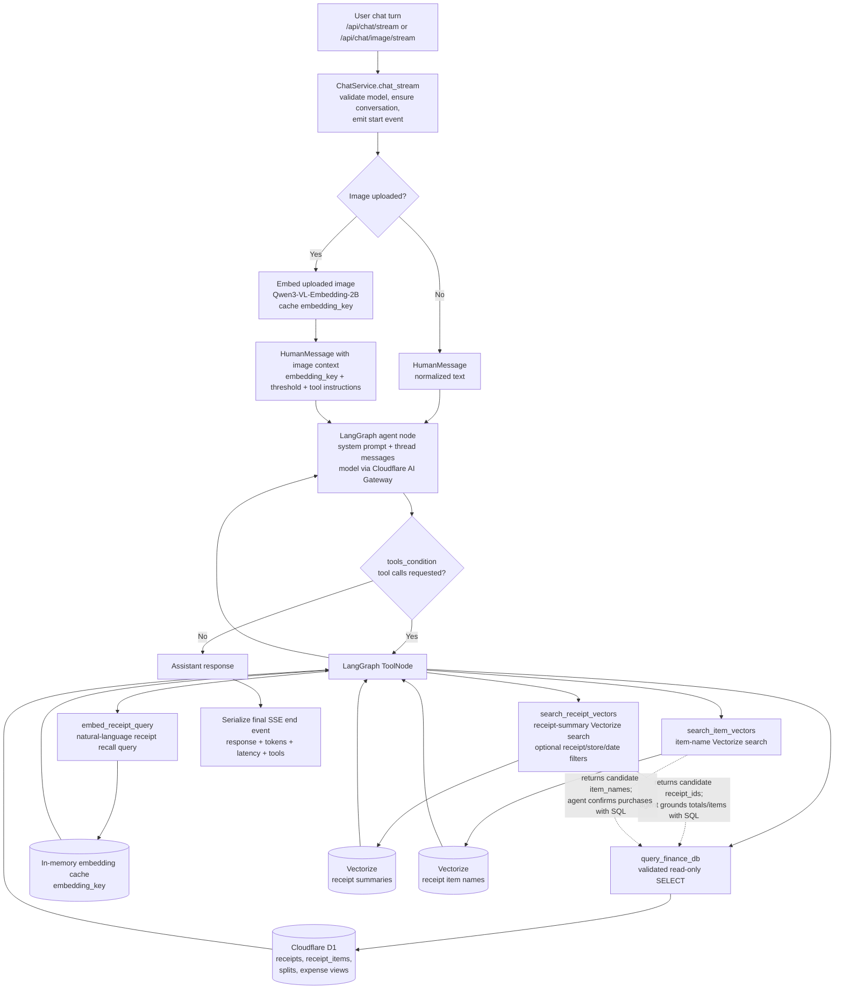

# Kirana

Kirana is a local grocery finance QA prototype for answering questions over household receipts, receipt line items, Splitwise exports, and query-time item images.

The current app is a FastAPI chat UI backed by a LangGraph agent. The agent calls a small set of tools for finance lookup and semantic retrieval, routes model calls through Cloudflare AI Gateway, stores chat threads in local SQLite, reads finance data from Cloudflare D1, and searches receipt/item embeddings in Cloudflare Vectorize. Receipt ingestion converts grocery receipt images into validated JSON, stores receipt and item rows in D1, uploads raw artifacts to Tigris, creates receipt summaries, and embeds those summaries for semantic search.

Against a plain-LLM baseline (no tools, receipts injected as context), the ablation isolates how much of the performance delta is attributable to the harness itself versus model scale.

## Goals

- Answer household grocery spending questions using receipt totals from the structured finance database.
- Answer personal contribution questions using Splitwise-derived views, especially `me_expenses.my_share_cents`.
- Support semantic grocery-trip recall, such as finding "fresh veggies" trips, by searching embedded receipt summaries and then grounding answers in receipt rows and line items.
- Support uploaded item-image questions by embedding the uploaded image, searching a Vectorize index built from distinct receipt item names, and confirming candidate matches against receipt line items in D1.
- Support conversational follow-ups in a thread, including drilling from a monthly total into receipt lists, date grouping, store breakdowns, item counts, and personal contribution for a selected date.
- Capture useful trace data through Logfire and local logs, including chat requests, model calls, retries, tool calls, D1 query timing, Vectorize retrieval timing, image embedding stages, token counts, and end-to-end turnaround time.
- Expose inline response stats in the chat stream, including latency, token counts, tool count, tool names, and rate-limit retries.

## Non-Goals

- Cross-session memory persistence
- Live receipt scanning or real-time camera ingestion
- Multi-user support or budget advisory features
- Automatic Splitwise API sync (manual CSV export only)
- Persistent local telemetry processes (Prometheus, Grafana, local OTel collectors)
- A polished production UI

## Architecture

### Chat App

- `app/main.py` serves the FastAPI app and static chat UI from `app/index.html`.
- `app/chat/service.py` owns the LangGraph chat graph, conversation persistence, streaming SSE responses, image-upload handling, rate-limit retries, and Logfire spans.
- Chat history is stored locally in `db.sqlite` through LangGraph's SQLite checkpointer. Conversation metadata is stored in a local `conversations` table.
- Models are configured in `app/config.toml` and called through Cloudflare AI Gateway via `app/chat/gateway.py`.
- The active tools are registered in the graph from `app/tools/finance.py` and `app/tools/vectorize.py`.



### Implemented Tools

- `query_finance_db`: runs validated read-only SQLite `SELECT` queries against the Cloudflare D1 finance database. It only allows known finance tables/views and blocks write or schema-changing statements.
- `embed_receipt_query`: embeds a natural-language retrieval query with `Qwen/Qwen3-VL-Embedding-2B` and stores the vector in an in-memory per-process cache.
- `search_receipt_vectors`: searches the receipt-summary Vectorize index with optional metadata filters for `receipt_id`, `store_name`, and `date`.
- `search_item_vectors`: searches the item-name Vectorize index. This is the main retrieval path for uploaded image questions and fuzzy item matching.

### Finance Store

Cloudflare D1 stores the structured finance data:

- `receipts`: one row per grocery receipt, including store, date, item count, subtotal, GST, discounts, total cents, and uploaded image URL.
- `receipt_items`: OCR-derived line items joined to `receipts.id`, including item name, quantity, unit price, total price, and inferred category.
- `splits`: imported Splitwise CSV rows with total cost and per-person amounts.
- `me_expenses`, `roommate1_expenses`, `roommate2_expenses`: views over `splits` that expose adjusted personal share columns.

## Knowledge Base & Modalities

### Receipt Images and OCR JSON

Receipt images are loaded from `knowledge-base/receipts/images` during ingestion. `app/ingest_receipts.py` runs the ingestion pipeline:

- Gemini extracts a structured receipt object from the image.
- Pydantic validates store, date, subtotal, GST, discounts, item totals, item names, quantities, and inferred categories.
- Mistral creates a natural-language receipt summary.
- D1 receives the receipt row and receipt item rows.
- The receipt summary is embedded with `Qwen/Qwen3-VL-Embedding-2B` and upserted into the receipt-summary Vectorize index.
- Tigris stores source artifacts and generated outputs for the ingested receipt.

### Splitwise Export

The Splitwise CSV path is configured in `app/config.toml` under `[knowledge_base].splitwise_csv_path`. `app/ingest_kb.py` imports the export into the `splits` table after converting money fields to integer cents. Splitwise data provides personal contribution and roommate share information that receipt OCR cannot infer.

### Query-Time Item Images

`POST /api/chat/image/stream` accepts an uploaded image and optional question. The backend resizes and embeds the image, stores the vector behind a short `embedding_key`, and injects that key into the chat turn. The agent then searches the item-name Vectorize index with `search_item_vectors` and confirms purchase evidence by querying `receipt_items` joined to `receipts`.

The assistant does not directly inspect the uploaded image pixels during the chat turn. It answers from item-vector matches and SQL-grounded receipt evidence.

### Vector Indexes

- `kirana-reciept-summaries`: receipt summary embeddings with indexed metadata for `receipt_id`, `store_name`, and `date`.
- `kirana-receipt-items`: distinct receipt item-name embeddings with indexed `item_name` metadata.

## Query Families

| Family | Query Shape | Implemented Capability |
|---|---|---|
| QF1: Household aggregation | Single-turn date-window totals. | Date-filtered receipt aggregation over `receipts.total_cents`. |
| QF2: Uploaded image purchase recall | Query-time item image matched against historical purchases. | Image embedding, item-vector search, and SQL confirmation against historical receipt line items. |
| QF3: Date and semantic trip analysis | Date-specific receipt totals, semantic trip discovery, and item inspection within identified trips. | Combination of D1 lookup, receipt-summary vector search, receipt ID narrowing, and line-item inspection. |
| QF4: Conversational drill-down | Multi-turn refinement from totals into receipts, grouped dates, stores, item counts, and personal share. | Threaded follow-up over prior context, structured receipt breakdowns, and Splitwise personal-share lookup. |

## Example Queries

### QF1

- How much did my household spend on groceries in the month of April?

### QF2

- Upload an item image and ask: have we ever bought this or something similar to this in our grocery trips before?

### QF3

- How much did I spend on 18th April? Can you list the receipts and the total amount spent?
- What were all the fresh veggies shopping trips in March?
- Can you tell me what I got at Woolworths in these identified trips?

### QF4

- How much did my household spend on groceries in the month of March?
- Can you list the different receipts involved in this as a list?
- Can you group them by date, list each date's total spend, and tell me which stores were involved on that day and how many items were in each store?
- Can you tell me what my contribution was for the groceries purchased on 18th March?

## Ablation Study

Research question: do in-context tool-sequence demonstrations improve agent performance over detailed procedural instructions alone?

The ablation is scoped to the system prompt. The agent architecture, tools, models, knowledge base, and benchmark set should remain fixed while only the prompt strategy changes.

| Condition | System Prompt Strategy | Purpose |
|---|---|---|
| A0: Procedural instructions | The current `app/prompts/system_prompt.md`: detailed rules for source selection, financial arithmetic, Splitwise reconciliation, Vectorize usage, uploaded image handling, and final-answer grounding. | Tests whether explicit instructions are enough for reliable tool routing and grounded synthesis. |
| A1: In-context tool demonstrations | A prompt variant that primarily teaches behavior through examples of user queries, tool-call sequences, intermediate tool results, and final grounded answers. | Tests whether few-shot demonstrations improve tool sequencing, source selection, and answer quality compared with instructions alone. |

The intended benchmark compares both prompts across the four query families while keeping the model and retrieval/data tools unchanged.

## Metrics

`app/bench.py` writes results to `app/kirana_agent_tools_and_instruction_following.json`
by default, or to the `--out` path when provided. Each query family records
`test_cases_passed`, `test_cases_total`, `model`, and per-case `details`.

### Correctness

- **QF-1 numeric correctness**: extracts the first numeric value from the answer and requires exact equality with the expected value.
- **QF-2 image recall correctness**: normalizes the answer to `yes` or `no` and compares it with the expected label.
- **QF-3 judged semantic correctness**: sends the question, expected answer, and agent response to the configured judge model. The case passes only when the judge returns exactly `YES`. Results include `judge_decision`, `judge_raw_response`, `judge_model`, and `judge_telemetry`.
- **QF-4 conversational numeric correctness**: runs follow-up turns in one thread, extracts the first numeric value from each answer, and requires exact equality with the expected value.
- **Case failures and errors**: each case stores `passed`, `actual`, `expected` or `expectation`, and `error` when the benchmark call or judge call fails.

### Runtime Telemetry

Each stored `agent_response` includes cumulative telemetry across the turns in that response:

- `latency_seconds`: sum of chat turn `total_tat_seconds` values from the streamed end events.
- `input_tokens`, `output_tokens`, and `total_tokens`.
- `tool_calls`: total tool-call count.
- `tools_called`: ordered list of tool names reported by the app.
- `rate_limit_retries`: total retries reported in chat message stats.
- `turns`: number of turns represented in the response, including prior turns for QF-4 follow-ups.

For QF-3, `judge_telemetry` separately records judge-call `latency_seconds`,
`input_tokens`, `output_tokens`, and `total_tokens`.

## Running Locally

Use Python 3.13+ and run commands from `app/`:

```sh
uv sync
uv run python main.py
```

Useful ingestion and indexing commands:

```sh
uv run python setup.py
uv run python ingest_kb.py
uv run python ingest_receipts.py
uv run python load_item_vectors.py
```

The app expects Cloudflare, Tigris, model gateway, and Logfire-related environment variables to be supplied through the local environment or `.env`. Raw receipts, exports, local databases, embeddings, and generated artifacts should stay out of git.
