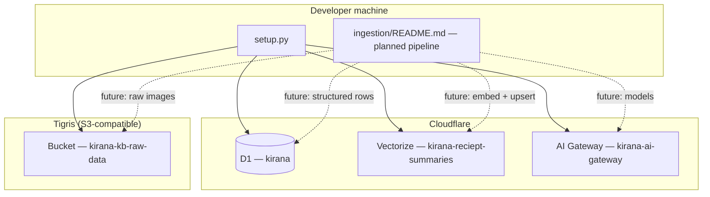

# Architecture

This document describes how the Kirana prototype is structured today, which parts live in code versus design docs only, and how data flows through the system. It is grounded in the repository layout and `backend/` sources.

## High-Level Picture

Kirana targets **grocery finance QA** over three modalities: receipt-derived structured data, Splitwise CSV exports, and optional pantry/item images at query time. The research framing (retrieval vs. model tier, hybrid SQL + RAG + cross-modal embeddings) is spelled out in the root [README](../README.md). This file focuses on **components and boundaries**.

**Solid lines:** what `backend/setup.py` provisions today.  
**Dotted lines:** flows described in [backend/ingestion/README.md](../backend/ingestion/README.md) that are **not** implemented as executable Python in this repo yet.

## Components and Roles

| Component | Role | Ground truth in repo |
|-----------|------|----------------------|
| **`backend/setup.py`** | One-shot provisioning: D1 schema, Vectorize index + metadata indices, AI Gateway, Tigris bucket. Reads `backend/infra.toml` and environment variables. | `setup.py`, `utils/db/db_setup.py`, `utils/types.py` |
| **`backend/infra.toml`** | Names and dimensions for Cloudflare/Tigris resources; single source of truth for resource identifiers used by setup. | File under `backend/` |
| **Cloudflare D1** | SQLite-compatible edge DB for `splits` (Splitwise import), `receipts`, and `receipt_items`. Cents-based money fields; `receipts.image_url` for object-store linkage. | DDL in `utils/db/db_setup.py` |
| **Cloudflare Vectorize** | Vector index for receipt-summary embeddings (intended shared space with pantry images per project README). Dimensions **1536**, metric **cosine**. Metadata fields: `receipt_id`, `store_name`, `date` (see `infra.toml`). | Created in `setup_vectorize` / `setup_vectorize_metadata_indices` |
| **Cloudflare AI Gateway** | HTTP gateway in front of hosted models (logging, cache TTL 3600s, BYOK provider keys in dashboard — not in `.env`). | `setup_ai_gateway` in `setup.py` |
| **Tigris object storage** | Raw receipt images; S3 API via `boto3` with endpoints from `infra.toml`. | `setup_tigris` |
| **Root README + ingestion README** | Product/research spec and **target** ingestion design (Gemini extraction, validation, summarisation, D1, embed, Tigris). | Spec only until a pipeline module lands under `backend/` |

Dependencies in `backend/pyproject.toml` (FastAPI, LangGraph, pydantic-ai, Chroma, etc.) anticipate future API and agent code; they are **not** wired to an application entrypoint in this repository snapshot—there is no `main.py` under `backend/` yet.

## Data Stores (Schema Summary)

**D1** tables created by setup (abbreviated; see `utils/db/db_setup.py` for full DDL):

- **`splits`:** Splitwise rows — `date`, `description`, `cost_cents`, `me_cents`, roommate columns, etc.
- **`receipts`:** One row per receipt — `store_name`, `date`, monetary fields in **cents**, `image_url`, timestamps.
- **`receipt_items`:** Line items linked by `receipt_id` — `item_name`, quantities, `inferred_category`, price fields in cents.

Indexes: `receipts(date)`, `receipt_items(receipt_id)`, `receipt_items(item_name)`.

**Vectorize** metadata indices exist so queries can filter/join on `receipt_id`, `store_name`, and `date`. The design docs sometimes mention additional metadata (e.g. totals); align any future ingestion code with `infra.toml` and recreate indices if the schema changes.

## Configuration Surfaces

| Surface | Purpose |
|---------|---------|
| `backend/.env` | Secrets and `KIRANA_DB_ID` (appended by setup when a new D1 DB is created). See [setup.md](./setup.md). |
| `backend/.env.example` | Placeholder variable names (no real secrets). |
| `backend/infra.toml` | Non-secret resource configuration consumed via `InfraConfig` in `utils/types.py`. |

## Public / Operational Workflow (Current)

1. **Provision infra:** `cd backend && uv sync && uv run python setup.py` (see [setup.md](./setup.md)).
2. **Configure AI Gateway** in the Cloudflare dashboard (authenticated gateway token, provider BYOK keys).
3. **Future:** receipt ingestion and query/agent paths as implemented—today they are specified in markdown, not as runnable modules in this tree.

## Constraints and Pitfalls

- **Do not assume ingestion or QA agents exist in code** because dependencies are listed; verify entrypoints and imports before extending behaviour.
- **Idempotency:** Re-running `setup.py` may fail if resources already exist (e.g. Vectorize index name, Tigris bucket). Treat the script as “bootstrap,” not a full reconcile loop.
- **Naming typo:** The Vectorize index name is `kirana-reciept-summaries` (as in `infra.toml`); code and docs should reference the same string when calling APIs.
- **Account check:** `setup.py` requires `CLOUDFLARE_API_TOKEN` and `CLOUDFLARE_ACCOUNT_ID` and validates them via the Cloudflare SDK before provisioning.

For credential sourcing and dashboard steps, use [setup.md](./setup.md). For the intended ingestion stages and observability model, use [backend/ingestion/README.md](../backend/ingestion/README.md) alongside this file.
