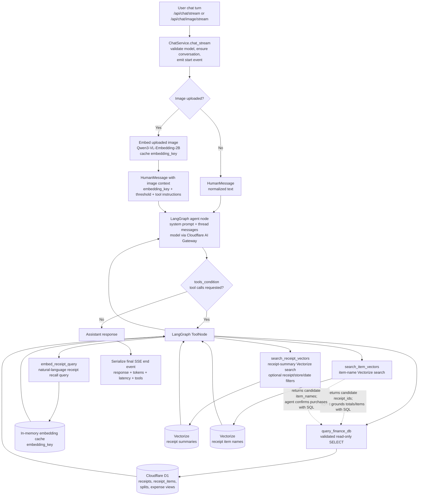

# Architecture

Kirana is a FastAPI chat UI backed by a LangGraph agent. The agent calls tools for finance lookup and semantic retrieval, routes model calls through Cloudflare AI Gateway, stores chat threads in local SQLite, reads finance data from Cloudflare D1, and searches receipt/item embeddings in Cloudflare Vectorize.

## Chat App

- `app/main.py` serves the FastAPI app and static chat UI from `app/index.html`.
- `app/chat/service.py` owns the LangGraph chat graph, conversation persistence, streaming SSE responses, image-upload handling, rate-limit retries, and Logfire spans.
- Chat history is stored locally in `db.sqlite` through LangGraph's SQLite checkpointer. Conversation metadata is stored in a local `conversations` table.
- Models are configured in `app/config.toml` and called through Cloudflare AI Gateway via `app/chat/gateway.py`.
- The active tools are registered in the graph from `app/tools/finance.py` and `app/tools/vectorize.py`.

## Code map

| Location | Responsibility |
|---|---|
| `app/main.py` | FastAPI app, static chat UI, conversation CRUD routes, SSE chat endpoints, startup wiring for logging, Logfire, D1, and `ChatService`. |
| `app/chat/service.py` | LangGraph graph (`agent` → `tools_condition` → `ToolNode` loop for most models), conversation SQLite metadata, streaming, image embedding for uploads, 429 backoff on LLM calls. |
| `app/chat/gateway.py` | Cloudflare AI Gateway OpenAI-compatible base URL and request headers (`cf-aig-authorization`, optional `cf-aig-byok-alias` for Gemini and Mistral identifiers). |
| `app/chat/schemas.py` | Pydantic models for API payloads, conversations, and message stats. |
| `app/tools/finance.py` | `query_finance_db` tool: validated read-only SQL against D1. |
| `app/tools/vectorize.py` | `embed_receipt_query`, `search_receipt_vectors`, `search_item_vectors` tools backed by in-process embedding cache and Cloudflare Vectorize. |
| `app/utils/db/d1.py` | HTTP client for Cloudflare D1 queries used by tools and setup. |
| `app/utils/db/db_setup.py` | D1 schema DDL invoked from `setup.py`. |
| `app/utils/config.py` / `app/utils/types.py` | Typed `config.toml` loading. |
| `app/ingestion/` | Receipt pipeline stages: Gemini OCR, validation, Mistral summary, embeddings, D1/Vectorize/Tigris I/O, rate limits, canonical logs. |
| `app/ingest_receipts.py`, `app/ingest_kb.py`, `app/load_item_vectors.py` | CLI entrypoints for receipts, Splitwise CSV, and item-name vectors. |
| `app/setup.py` | Provisions D1, Vectorize indexes, AI Gateway, Tigris bucket. |
| `app/bench.py` | Query-family benchmark driver over the live HTTP API. |

## Agent routing (Gemini vs other models)

The graph is always a two-node LangGraph: `agent` and `tools` with `tools_condition` (`app/chat/service.py`). Behavior inside the agent node depends on the selected model identifier:

- **Non-Gemini models** (for example Mistral): the chat model is invoked with `bind_tools`, LangGraph routes to `ToolNode` when the model emits tool calls, and tool results are fed back through the normal loop. Tool names in SSE stats come from `ToolMessage` / `tool_calls` on the message history.

- **Gemini routes** (`model_routes_via_gemini` in `app/chat/gateway.py`): the agent node does **not** use the LangGraph `ToolNode` for execution. Instead `_gemini_agent_response` runs up to **three** internal tool-request rounds: each round calls the model with tools bound, executes requested tools in process, appends plain `ToolMessage` content, and continues. If tools are still requested after three rounds, a final synthesis call asks the model to answer from the accumulated tool text without further tools. This avoids replaying Gemini function-call parts through the OpenAI-compatible tool loop (which can fail when Gemini requires `thought_signature` metadata). Ordered tool names for telemetry are stored on the final `AIMessage` under `additional_kwargs["kirana_tool_names"]`.

The diagram below shows the **non-Gemini** path where `tools_condition` routes to LangGraph `ToolNode`. For Gemini, tools run inside the agent node as above, and the conditional edge to `ToolNode` is not used for those internal tool rounds.

## Implemented Tools

- `query_finance_db`: runs validated read-only SQLite `SELECT` queries against the Cloudflare D1 finance database. It only allows known finance tables/views and blocks write or schema-changing statements.
- `embed_receipt_query`: embeds a natural-language retrieval query with `Qwen/Qwen3-VL-Embedding-2B` and stores the vector in an in-memory per-process cache.
- `search_receipt_vectors`: searches the receipt-summary Vectorize index with optional metadata filters for `receipt_id`, `store_name`, and `date`.
- `search_item_vectors`: searches the item-name Vectorize index. This is the main retrieval path for uploaded image questions and fuzzy item matching.

### Uploaded-image chat turns

`ChatService` embeds the upload before the graph runs and places the resulting `embedding_key` in the `HumanMessage` text (`app/chat/service.py`). The model never receives raw pixels in chat. For those turns, retrieval is **`search_item_vectors` → `query_finance_db`**, not `embed_receipt_query` + `search_receipt_vectors` (receipt-summary search is for semantic trip themes from text, using keys produced by `embed_receipt_query`).

## Finance Store

Cloudflare D1 stores the structured finance data:

- `receipts`: one row per grocery receipt, including store, date, item count, subtotal, GST, discounts, total cents, and uploaded image URL.
- `receipt_items`: OCR-derived line items joined to `receipts.id`, including item name, quantity, unit price, total price, and inferred category.
- `splits`: imported Splitwise CSV rows with total cost and per-person amounts.
- `me_expenses`, `roommate1_expenses`, `roommate2_expenses`: views over `splits` that expose adjusted personal share columns.

## Knowledge Base and Modalities

### Receipt Images and OCR JSON

Receipt images are loaded from `knowledge-base/receipts/images` during ingestion. `app/ingest_receipts.py` runs the ingestion pipeline:

- Gemini extracts a structured receipt object from the image.
- Pydantic validates store, date, subtotal, GST, discounts, item totals, item names, quantities, and inferred categories.
- Mistral creates a natural-language receipt summary.
- D1 receives the receipt row and receipt item rows.
- The receipt summary is embedded with `Qwen/Qwen3-VL-Embedding-2B` and upserted into the receipt-summary Vectorize index.
- Tigris stores source artifacts and generated outputs for the ingested receipt.

### Splitwise Export

The Splitwise CSV path is configured in `app/config.toml` under `[knowledge_base].splitwise_csv_path`. `app/ingest_kb.py` imports the export into the `splits` table after converting money fields to integer cents. Splitwise data provides personal contribution and roommate share information that receipt OCR cannot infer.

### Query-Time Item Images

`POST /api/chat/image/stream` accepts an uploaded image and optional question. The backend resizes and embeds the image, stores the vector behind a short `embedding_key`, and injects that key into the chat turn. The agent then searches the item-name Vectorize index with `search_item_vectors` and confirms purchase evidence by querying `receipt_items` joined to `receipts`.

The assistant does not directly inspect the uploaded image pixels during the chat turn. It answers from item-vector matches and SQL-grounded receipt evidence.

### Vector Indexes

- `kirana-reciept-summaries`: receipt summary embeddings with indexed metadata for `receipt_id`, `store_name`, and `date`.
- `kirana-receipt-items`: distinct receipt item-name embeddings with indexed `item_name` metadata.
