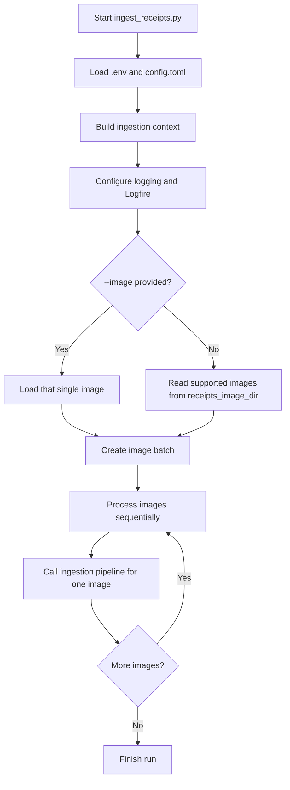
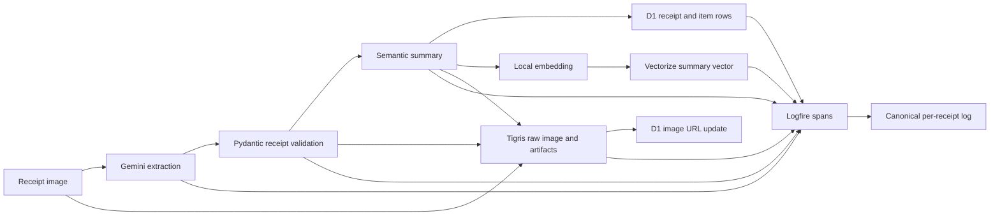
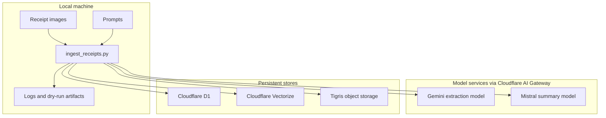
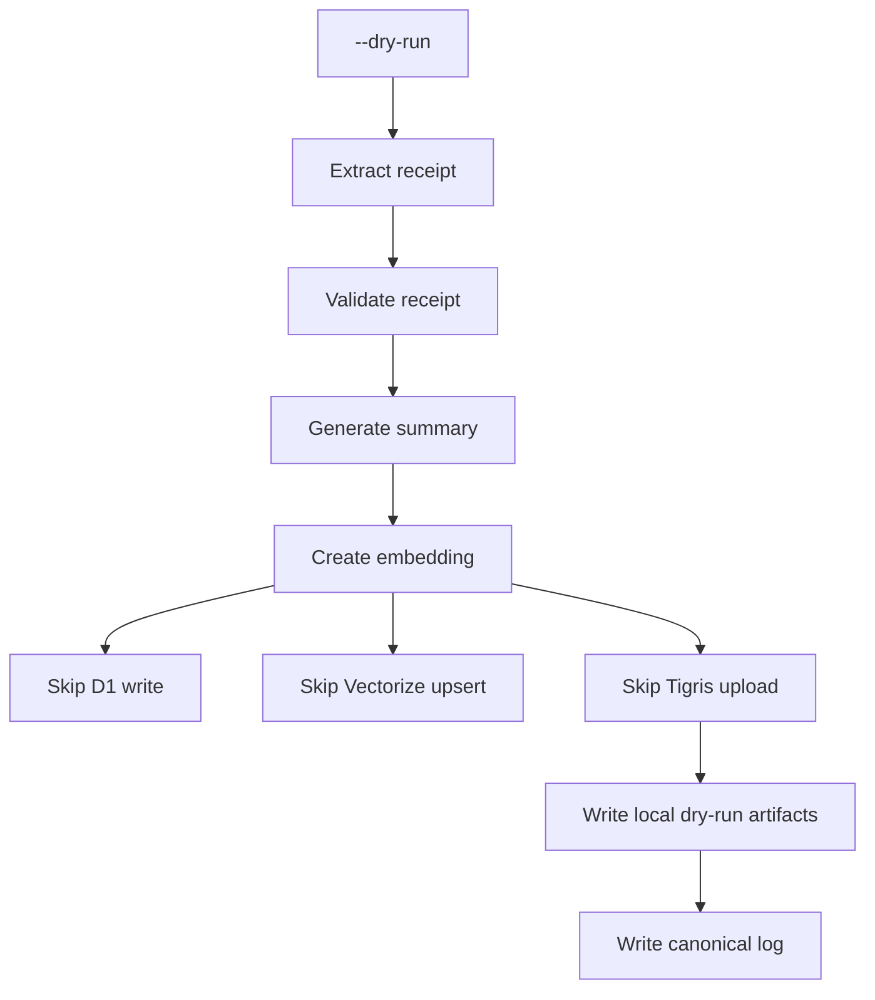

# Receipt Ingestion CLI

`backend/ingest_receipts.py` is the local entry point for turning receipt images into searchable grocery finance knowledge. It is a batch-oriented CLI: it reads one receipt image or a configured image directory, prepares the shared ingestion services, and processes receipts one at a time through the ingestion pipeline.

The script is intentionally thin. Most work happens in the ingestion modules under `backend/ingestion/`, while this CLI owns application startup, input selection, dry-run mode, and per-image orchestration.

---

## How to Run

Run from `backend/`:

```sh
uv run python ingest_receipts.py
```

Process one specific image:

```sh
uv run python ingest_receipts.py --image ../knowledge-base/receipts/images/example.jpg
```

Exercise the full model and local artifact flow without writing to D1, Vectorize, or Tigris:

```sh
uv run python ingest_receipts.py --dry-run
```

Use a non-default config file:

```sh
uv run python ingest_receipts.py --config config.toml
```

---

## Application Flow



At startup, the CLI loads configuration and credentials, creates API clients for Cloudflare and Tigris, initializes the embedding model, and prepares the model agents routed through Cloudflare AI Gateway. It then resolves the input set:

- `--image` limits the run to a single file.
- Without `--image`, the configured `receipts_image_dir` is scanned for supported image files.
- Images are processed sequentially so rate limits, logs, and failures are easy to inspect.

---

## One Receipt Through the Pipeline



For each image, the pipeline extracts a structured receipt, validates it, summarizes the shopping trip, writes structured rows, embeds the summary, stores the vector for semantic search, archives source artifacts, and records a canonical log line. The resulting data supports both SQL-style accounting questions and semantic retrieval over receipt summaries.

The high-level purpose of each stage is:

| Stage | What it does | Why it matters |
|---|---|---|
| Image loading | Reads receipt bytes and basic file metadata from disk. | Gives the pipeline a consistent image input regardless of single-image or batch mode. |
| Receipt extraction | Uses a vision-capable model to convert the image into structured receipt data. | Turns visual receipts into machine-readable grocery facts. |
| Validation | Checks that the extracted receipt matches the expected schema and accounting constraints. | Prevents malformed or obviously inconsistent data from entering the knowledge base. |
| Summary generation | Produces a short semantic description of the shopping trip. | Creates a retrieval surface for questions that are not simple exact SQL lookups. |
| D1 write | Stores receipt-level and item-level structured data. | Supports deterministic finance, date, total, store, and item queries. |
| Embedding and Vectorize upsert | Converts the summary into a vector and stores it with receipt metadata. | Enables semantic and hybrid retrieval. |
| Tigris archival | Stores the raw image plus derived OCR and summary artifacts. | Keeps source evidence and derived artifacts available outside the database. |
| Canonical logging | Writes a compact success or failure record with timings, tokens, retries, and outcome. | Makes ingestion runs auditable and comparable during evaluation. |

---

## Data Movement



The CLI coordinates local files, hosted model calls, and remote storage. It does not run as a hosted service and does not watch for filesystem changes. Each execution is an explicit local batch run.

---

## Dry-Run Mode

Dry-run mode keeps the expensive and diagnostic parts of the flow while skipping persistent remote writes:



This is useful when checking prompt changes, validation behaviour, model access, or logging without mutating the shared knowledge base. Dry-run still records logs and local artifacts so the output can be inspected after the run.

---

## Failure and Logging Behaviour

The CLI processes receipts independently. A failure on one image is captured in that image's canonical log and does not require the whole batch to be retried manually from scratch. The next image can continue through the same top-level loop.

Every receipt produces:

- A Logfire trace with spans for the major ingestion stages.
- A canonical log entry with outcome, error message if any, retry counts, token counts, and total elapsed time.
- In dry-run mode, local artifacts under the configured logs directory.

This keeps the ingestion path observable without hiding routing, model choice, or persistence decisions inside prompts.

---

## Relationship to the Broader Ingestion Design

`ingest_receipts.py` is the runnable application wrapper around the receipt pipeline described in [Ingestion Pipeline](./ingestion.md). Use this page to understand how a local CLI run moves from command-line arguments to receipt processing. Use the broader ingestion document for storage responsibilities, retry assumptions, Splitwise separation, and evaluation constants.
