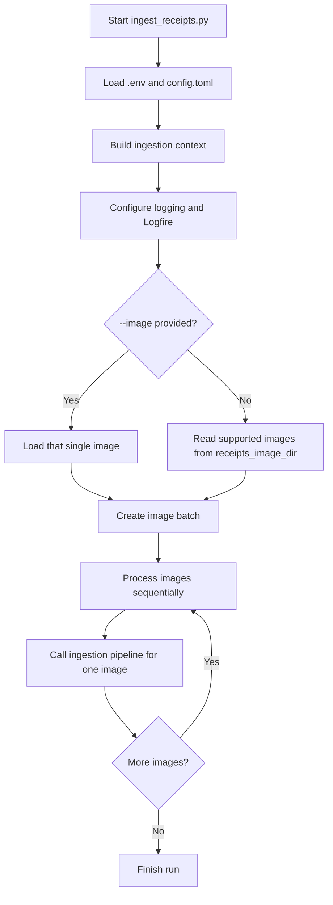
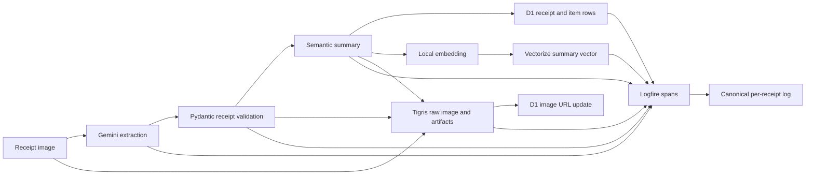
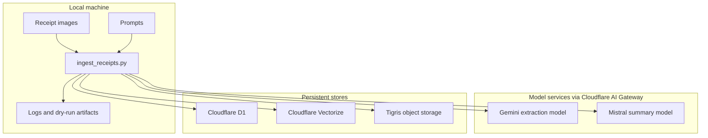
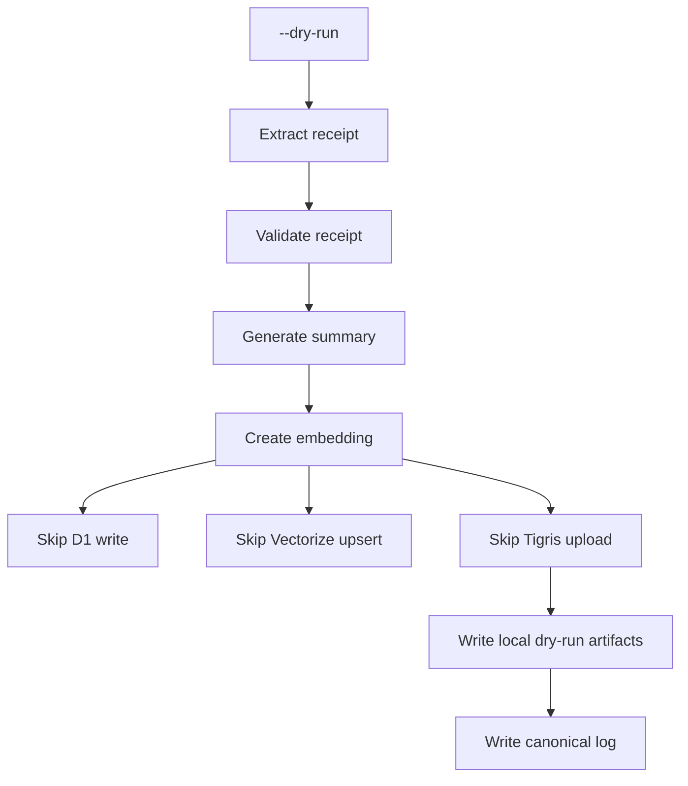

# Kirana Ingestion Pipeline

## Overview

Kirana ingestion is a set of local, explicitly-run flows that populate the grocery finance knowledge base. The receipt image flow and the Splitwise CSV import are part of the same ingestion boundary, but they are executed independently:

- Receipt images run through `app/ingest_receipts.py`, which extracts, validates, summarizes, embeds, stores, archives, and logs each receipt.
- Receipt item names run through `app/load_item_vectors.py` after receipt ingestion, embedding distinct `receipt_items.item_name` values into a separate Vectorize index for item/image matching.
- Splitwise exports are imported as a separate one-shot CSV flow into D1. They do not use VLM extraction, embedding, Vectorize, or Tigris.

The receipt flow writes to three persistent stores: Cloudflare D1 for structured receipt and item rows, Cloudflare Vectorize for semantic retrieval over receipt summaries, and Tigris for raw image and derived artifact archival. The pipeline runs on demand from the local machine; there is no hosted orchestrator or filesystem watcher.

---

## How to Run Receipt Ingestion

Run from `app/`:

```sh
uv run python ingest_receipts.py
```

Process one specific image:

```sh
uv run python ingest_receipts.py --image ../knowledge-base/receipts/images/example.jpg
```

Exercise the full model and local artifact flow without writing to D1, Vectorize, or Tigris:

```sh
uv run python ingest_receipts.py --dry-run
```

Use a non-default config file:

```sh
uv run python ingest_receipts.py --config config.toml
```

`ingest_receipts.py` is intentionally thin. Most work happens in `app/ingestion/`; the CLI owns startup, config loading, input selection, dry-run mode, and per-image orchestration.

---

## How to Run Item Vector Ingestion

Run this after receipt ingestion has populated D1:

```sh
uv run python load_item_vectors.py
```

Exercise the D1 read and local embedding flow without writing to Vectorize:

```sh
uv run python load_item_vectors.py --dry-run
```

The item flow reads:

```sql
SELECT DISTINCT item_name FROM receipt_items;
```

It skips null or blank names, normalizes whitespace, deduplicates case-insensitively, embeds each item name locally, and upserts each vector individually into the configured `cloudflare.vectorize_item_index_name`. If the run fails after writing any item vectors, the script deletes the vectors it wrote in that run before exiting so the item index is not left with partial bad entries. Each vector stores the item name in metadata:

```json
{
  "item_name": "Baby Spinach"
}
```

This index is intentionally separate from the receipt-summary index. Uploaded image questions use the image embedding against the item-name index first, then the chat agent verifies any matched item names through SQL joins over `receipt_items` and `receipts`.

---

## How to Run Splitwise Import

Configure the CSV path in `app/config.toml`:

```toml
[knowledge_base]
splitwise_csv_path = "../knowledge-base/splitwise/splitwise-export-26-04-2026.csv"
```

Then run from `app/`:

```sh
uv run python ingest_kb.py
```

The importer reads the configured CSV, skips empty rows and rows without a cost, converts money fields to integer cents, and inserts batched rows into the `splits` table. It expects `CLOUDFLARE_ACCOUNT_ID`, `CLOUDFLARE_API_TOKEN`, and `KIRANA_DB_ID` to be available in `app/.env` or the shell.

### CSV column contract

`app/ingest_kb.py` reads every data row as a list of string cells, then converts **money** columns using **0-based indices** on the raw Splitwise export row (after the header row is skipped):

| Index | Usage |
|---:|---|
| `3` | Total expense cost; rows with an empty value here are skipped. |
| `5` | Primary user amount (`me_cents` after conversion). |
| `6` | Roommate 1 amount. |
| `7` | Roommate 2 amount. |

All columns from the row are trimmed and inserted in order into `date`, `description`, `category`, `cost_cents`, `currency`, `me_cents`, `roommate1_cents`, `roommate2_cents`. If your export layout differs, remap columns before import or adjust the constants in `ingest_kb.py`.

---

## Receipt CLI Application Flow



At startup, the CLI loads configuration and credentials, creates API clients for Cloudflare and Tigris, initializes the embedding model, and prepares model agents routed through Cloudflare AI Gateway. It then resolves the input set:

- `--image` limits the run to a single file.
- Without `--image`, the configured `receipts_image_dir` is scanned for supported image files.
- Images are processed sequentially so rate limits, logs, and failures are easy to inspect.

---

## One Receipt Through the Pipeline



| Stage | What it does | Why it matters |
|---|---|---|
| Image loading | Reads receipt bytes and basic file metadata from disk. | Gives the pipeline a consistent image input regardless of single-image or batch mode. |
| Receipt extraction | Uses Gemini Flash through Cloudflare AI Gateway to convert the image into structured receipt data. | Turns visual receipts into machine-readable grocery facts. |
| Validation | Checks that the extracted receipt matches the expected Pydantic schema and accounting constraints. | Prevents malformed or obviously inconsistent data from entering the knowledge base. |
| Summary generation | Uses a cheaper text model to produce a short semantic description of the shopping trip. | Creates a retrieval surface for questions that are not simple exact SQL lookups. |
| D1 write | Stores receipt-level and item-level structured data. | Supports deterministic finance, date, total, store, and item queries. |
| Embedding and Vectorize upsert | Embeds the summary locally and stores it with receipt metadata. | Enables semantic and hybrid retrieval. |
| Tigris archival | Stores the raw image plus derived receipt and summary artifacts. | Keeps source evidence and derived artifacts available outside the database. |
| Canonical logging | Writes a compact success or failure record with timings, tokens, retries, and outcome. | Makes ingestion runs auditable and comparable during evaluation. |

---

## Receipt Extraction and Validation

The image is sent to Gemini Flash via Cloudflare AI Gateway. The model is prompted to extract a structured JSON document containing:

- `store_name`
- `date`
- `address`
- `items`, including item name, quantity, unit price, inferred category, and line total
- `subtotal`, `gst`, and `discounts`

The extracted JSON is validated against Pydantic models. Validation checks include:

- All required fields are present.
- Line-item totals are consistent with the receipt subtotal within the configured sum tolerance.
- The receipt date is parseable and not in the future.

On extraction or validation failure, the error is injected back into the prompt and the request is retried. Cloudflare AI Gateway handles network-level retries such as 5xx responses and timeouts; the schema and accounting retry loop lives in application code. Maximum retry attempts and failure behaviour must be fixed before evaluation runs.

Each extraction attempt is logged in Logfire with attempt number and error reason.

---

## Summary, Embedding, and Storage

After validation, the receipt JSON is passed to a cheaper text model, currently represented by the Mistral summary path. The prompt asks for a short natural-language summary of the shopping trip's semantic character: category skew, estimated scale, notable items, and other features useful for retrieval. It should not be a simple restatement of every line item.

The semantic summary is embedded locally using the configured Qwen embedding model and upserted into Cloudflare Vectorize with receipt metadata such as:

```json
{
  "receipt_id": 42,
  "store_name": "woolworths-metro",
  "date": 20260315
}
```

`date` is stored as a numeric `YYYYMMDD` value because the Vectorize metadata index is a number index. Query-time date filters should use numeric ranges, for example `{"date": {"$gte": 20260401, "$lt": 20260501}}`. The chat Vectorize search tool also normalizes ISO `YYYY-MM-DD` filter values to this numeric form before calling Cloudflare.

Receipt-summary vectors and item-name vectors live in separate Vectorize indexes. Receipt-summary search uses `cloudflare.vectorize_index_name`; uploaded image questions use the image embedding against `cloudflare.vectorize_item_index_name`, then verify matched item names through SQL.

Structured receipt and item rows are inserted into Cloudflare D1. D1's receipt ID is the join key referenced by Vectorize metadata and by the Tigris artifact path. The raw receipt image and derived artifacts are uploaded to Tigris under receipt-ID-prefixed keys such as `42/42-image.jpg`, `42/42-ocr.json`, and `42/42-summary.txt`, then the resulting image URL is written back to the corresponding D1 receipt row.

---

## Data Movement



The CLI coordinates local files, hosted model calls, and remote storage. Each execution is an explicit local batch run.

---

## Dry-Run Mode

Dry-run mode keeps the expensive and diagnostic parts of the flow while skipping persistent remote writes:



This is useful when checking prompt changes, validation behaviour, model access, or logging without mutating the shared knowledge base. Dry-run still records logs and local artifacts so the output can be inspected after the run.

---

## Splitwise Import

Splitwise data is exported manually as a CSV and imported directly into a D1 table, currently represented as `splits`. No VLM, embedding, Vectorize, or Tigris steps are involved.

The join between `splits` and `receipts` is fuzzy: matched on date proximity and total amount. Tolerance constants, such as date window and amount tolerance, must be fixed before query logic is evaluated. Ambiguous matches, including one Splitwise entry spanning multiple receipts, are flagged for LLM mediation at query time rather than resolved during ingestion.

This separation is intentional. Receipt ingestion produces evidence and retrieval surfaces; Splitwise import provides independent accounting records for reconciliation.

---

## Observability

All major receipt stages are instrumented as Pydantic Logfire spans. Each processed receipt produces:

- A Logfire trace with spans for extraction, validation, summary, D1 writes, embedding, Vectorize upsert, Tigris upload, and D1 image URL update.
- A canonical log entry with outcome, error message if any, retry counts, token counts, total elapsed time, dry-run status, and validation tolerance.
- In dry-run mode, local artifacts under the configured logs directory.

There are no persistent local telemetry services. Traces go to Logfire, and local artifacts/logs exist only as explicit run output.

---

## Error Handling

The CLI processes receipts independently. A failure on one image is captured in that image's canonical log and does not require the whole batch to be retried manually from scratch. The next image can continue through the same top-level loop.

| Step | Failure mode | Behaviour |
|---|---|---|
| Gemini extraction | JSON unparseable or invalid | Retry with error in prompt up to configured limit, then skip and log. |
| Pydantic validation | Field missing, date invalid, or accounting mismatch | Same retry loop as extraction. |
| D1 insert | Database error | Abort this receipt, log failure, and skip downstream persistent writes. |
| Vectorize upsert | API error | Log failure; the receipt may exist in D1 but not be retrievable via RAG. |
| Tigris upload | API error | Log failure; structured data may be queryable but the image may not be archived. |

---

## Constants to Fix Before Evaluation

- Maximum JSON extraction retry attempts.
- Pydantic sum-of-items tolerance.
- Splitwise fuzzy join tolerance, including date window and amount tolerance.
- Numerical answer tolerance for evaluation: `±$3` or `±5%`, whichever is larger.
